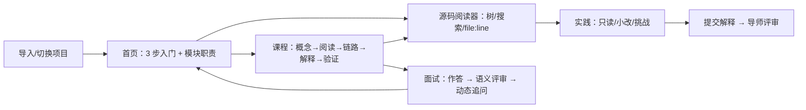
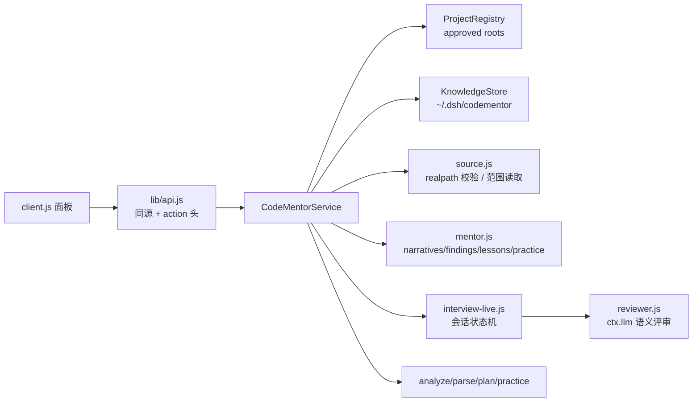

# CodeMentor v2 — Project Code Learning & Engineering Mentor

把代码仓库转化为**可导入、可阅读、可练习、可面试、可验证**的工程训练环境。CodeMentor 是 DeepSeek Harness（DSH）的 Cordis 插件，不修改 Agent Loop，不重复实现文件读取、搜索、终端、模型调用与会话持久化能力。

- 包名：`@local/codementor`
- 版本：`2.0.0`
- 运行形态：Host 插件（8 个工具 + 系统提示段 + 项目/源码/面试 API）+ Client 插件（CodeMentor 面板）
- 数据目录：`~/.dsh/codementor`（可用 `dataDir` 覆盖），**不写入业务仓库**
- 自动化测试：**40 passed, 0 failed**

---

## 1. v2 改了什么

针对评审指出的 P0/P1 问题，v2 不是换文案，而是补齐真实交互闭环：

| 问题 | v2 实现 |
|---|---|
| 无法导入/切换项目 | 面板输入本地目录 → `POST /projects/scan` 真实扫描 → 自动进入项目首页；项目选择器切换缓存项目；导入/扫描成功后登记 approved root |
| 代码探索看不到源码 | 服务端文件树 + 受控源码读取 API；左侧树/搜索，右侧真实源码、行号、目标行高亮；点击模块/调用链/证据/符号统一 `openSource(file,line)` |
| 面试间只能看题库 | 面板内开始面试、多行输入、Ctrl+Enter 提交；作答前**不返回**参考答案/评分要点/预期事实；提交后由 Host 默认模型做语义评审并生成基于本次回答的追问 |
| 模块职责不直观 | 每模块生成 `summary / responsibility / inputs / outputs / upstream / downstream / startHere / confidence` 自然语言卡片 |
| 结论与证据看不懂 | 首页默认只展示 3–5 条“核心发现与源码依据”，底层 claims 折叠到“分析详情” |
| 学习路线太浅 | 课程级 `lesson`：概念 → 阅读入口 → 追踪调用链 → 解释问题 → 低风险验证；含完成标准、前置、预计时间、状态 |
| 实践题像静态模式 | 分“入门理解（只读）/ 小型修改 / 工程挑战”；候选风险 ≠ 已确认 Bug；完成解释可请求导师评审 |
| 项目切换串状态 | 面板以 `projectId` 为 key 重挂载；取消旧请求；每个项目独立知识、课程进度、面试会话 |

---

## 2. 快速开始

### 2.1 安装

```text
plugin_manager action=install_bundle target="C:/Users/28935/Documents/deepseek-harness/default-workspace/codementor"
```

安装结果：`application: applied`；侧边栏出现 **CodeMentor**；8 个 `codementor_*` 工具注册；`sidebar.panellist#codementor` 与 `main#codementor` 均为 active。

> 修改 Host 代码后，用 `plugin_manager action=set_plugin target=include:codementor enabled=false` 再 `enabled=true` 重新加载；修改 `client.js` 后需要刷新浏览器页面加载新客户端模块。

### 2.2 面板使用

1. 点击侧边栏 **CodeMentor**。
2. 首次使用：在“导入本地项目”输入本机目录（如 `C:\work\my-project`），点“导入并扫描”。
3. 首页会显示：项目简介、3 步入门、真实调用链、核心模块卡片、核心发现与源码依据。
4. 点“开始第一课”进入课程；点模块“从这里开始”/证据链接进入源码阅读器。
5. “面试”页选择难度/目标/题数 → 开始 → 输入回答 → 提交 → 查看点评与下一问。

### 2.3 工具入口（Agent 侧仍可用）

```text
codementor_scan path="C:/path/to/project"
codementor_overview path="C:/path/to/project"
codementor_explore path="C:/path/to/project" target="cmd_dispatch" mode="chain"
codementor_roadmap path="C:/path/to/project" goal=onboarding level=intermediate mode=2h
codementor_progress path="C:/path/to/project" action=record module="Core/Src" level=2 evidence_kind=explained detail="..." ref="Core/Src/main.c:249"
codementor_practice path="C:/path/to/project" action=list
codementor_practice path="C:/path/to/project" action=verify task_id="#1" authorized=true
codementor_interview path="C:/path/to/project" action=start difficulty=mid max_questions=3
codementor_refresh path="C:/path/to/project"
```

---

## 3. 交互闭环



- 所有源码位置共享同一个导航入口：`openSource(projectId, file, line)`。
- 作答前当前题只返回 `questionId/prompt/dimension/difficulty/kind/why`；答案、rubric、预期事实留在 Host。
- 课程“标记完成”必须有解释 + `file:line` 证据，不能只点按钮。

---

## 4. 架构



### 新增/重构文件

| 文件 | 职责 |
|---|---|
| `lib/projects.js` | approved root 注册表；只接受 id，服务端解析 realpath，拒绝移动/越界根 |
| `lib/source.js` | 文件树、范围读取、符号片段；拒绝 `..`、绝对路径、符号链接逃逸、敏感文件、超大文件 |
| `lib/mentor.js` | 模块自然语言叙事、核心发现、3 步入门、课程模型、分级实践视图 |
| `lib/reviewer.js` | Host 端语义评审：当前默认模型 + 严格 JSON + 证据校验 + 超时/降级 |
| `lib/interview-live.js` | 面试状态机：asking → reviewing → asking/finished；turnId 幂等；动态追问 |
| `lib/api.js` | 项目/源码/课程/面试 HTTP API；写操作同源校验与 action 头 |
| `client.js` | 五页签交互面板（首页/路线/源码/实践/面试） |

---

## 5. API

所有写操作需 `x-codementor-action: 1` + `content-type: application/json`；若携带 `Origin`，必须与 `Host` 一致。

| 方法 | 路径 | 说明 |
|---|---|---|
| GET | `/api/codementor/state` | 插件信息、项目列表、评审器可用性 |
| GET | `/api/codementor/projects` | 已导入项目 |
| POST | `/api/codementor/projects/scan` | `{path}` 导入并扫描本地目录 |
| GET | `/api/codementor/project?id=` | 面板视图（首页/课程/实践/面试） |
| POST | `/api/codementor/project/refresh` | `{projectId}` 增量刷新并重扫变化文件 |
| GET | `/api/codementor/tree?projectId=` | 文件树 |
| GET | `/api/codementor/file?projectId=&path=&start=&end=` | 真实源码范围 |
| GET | `/api/codementor/symbol?projectId=&symbolId=` | 函数签名、调用方、被调用方 |
| GET | `/api/codementor/lessons?projectId=` | 课程与进度 |
| POST | `/api/codementor/lesson/update` | 开始/完成课程（完成需证据） |
| POST | `/api/codementor/learning/save` | 收藏源码位置 |
| POST | `/api/codementor/interview/start` | 开始一轮 |
| GET | `/api/codementor/interview?projectId=` | 当前题/历史/报告 |
| POST | `/api/codementor/interview/answer` | `{sessionId,turnId,answer}` 提交回答 |
| POST | `/api/codementor/interview/finish` | 结束本轮 |
| POST | `/api/codementor/practice/review` | 提交实践解释请求导师评审 |

---

## 6. 安全

- **项目根**：只从 `ProjectRegistry` 的 approved root 解析；客户端只传 `projectId`，不传绝对路径。
- **路径**：拒绝 `..`、盘符绝对路径、NUL；`realpath` 后再次校验仍在根内；符号链接逃逸拒绝。
- **文件**：允许源码/配置/文档白名单；拒绝 `.env`、私钥、证书、keystore；单文件 ≤2 MiB，单次 ≤600 行。
- **写请求**：同源 + `x-codementor-action` + JSON；跨站 `Sec-Fetch-Site` 拒绝；请求体上限 512 KiB。
- **模型**：只在 Host 调用 `ctx.llm`，浏览器无 API Key；只发送题目、回答、有限证据片段，不发送整个仓库。
- **仓库文本是不可信数据**：不执行源码/README 中的指令；修改、终端、Git 写操作仍需显式授权。
- **降级透明**：无模型路由时评审明确标为“规则诊断”，不伪装成语义评分。

---

## 7. 学习课程

课程模型示例：

```json
{
  "lessonId": "lesson:core-src",
  "title": "读懂 Core/Src：程序入口与主循环",
  "whyLearn": "……",
  "prerequisites": ["Core/Inc"],
  "learningObjectives": ["能说清职责", "能沿真实调用点解释链路", "能给出 file:line"],
  "steps": [
    { "type": "concept", "title": "先理解它解决什么问题", "content": "……" },
    { "type": "read", "title": "阅读推荐入口", "target": { "file": "Core/Src/main.c", "line": 135 } },
    { "type": "trace", "title": "追踪一条真实调用链", "chainId": "entry:program-entry:main", "steps": [] },
    { "type": "explain", "title": "用自己的话解释", "prompt": "……" },
    { "type": "verify", "title": "做一次低风险验证", "readOnly": true }
  ],
  "completionCriteria": ["能不看笔记说出职责", "能指出至少两个 file:line", "能解释一个失败/边界路径"],
  "estimatedMinutes": 30,
  "status": "not_started"
}
```

进度按项目独立保存到 knowledge.json；完成需要 `detail` + `ref`（`file:line`）。

---

## 8. 面试语义评审

- 评审器在 Host：`ctx.get('llm')` + `ctx.get('agentDefaultModel').currentSelection()`。
- 为控制推理 token 消耗，评审请求使用模型最低 reasoning effort，并把 `maxTokens` 提到 4096；超时 120 秒。
- 输出结构化 JSON：`correctPoints / incorrectPoints / missingPoints / uncertainties / dimensions(0-5) / overallComment / improvedAnswer / decision / nextQuestion / evidence`。
- 证据校验：模型给出的 `file:line` 必须命中已知文件，否则移入 `uncertainties`。
- 决策：`followup / clarify / next / finish`；追问文本来自本次回答，不是固定模板。
- 同一 `turnId` 重复提交只返回第一次结果，不重复计分。
- 无模型时降级为规则诊断，并明确标注。

---

## 9. 真实仓库验收（2026-10-30）

仓库：`C:\Users\28935\Desktop\pp\批量转台球式\自研开发板STM32F407`（C / Keil + IAR + CubeMX 多模块工程）。

| 验收 | 实测 |
|---|---|
| 项目导入 | `POST /projects/scan` 返回 200，项目登记为 approved root，自动进入首页 |
| 项目切换 | 自动化 API 测试（fixture A/B）：项目 id 独立，视图 meta/projectId 对应，旧请求取消 |
| 文件树/源码 | 树 1678 项；`Core/Src/main.c` 240–255 行真实内容；`../../Windows/win.ini` → 403 `PATH_TRAVERSAL` |
| 新增文件 | 自动化 API 测试（fixture）：新增 `src/new_module.c`，refresh 后文件树可见 |
| 课程 | 3 课（Core/Inc → Core/Src → MDK-ARM）；完成缺证据 → 409；带 `src/main.c:5` → 200 |
| 面试隐藏答案 | start 返回当前题不含 `recommended/expectedFacts/rubric` |
| 语义评审 | 真实模型 `semantic=true`，维度 `technicalAccuracy=3, sourceGrounding=2, engineeringTradeoffs=2, communication=3`，decision=`followup` |
| 追问依赖回答 | 对错误回答（EPOLL/ET 内容）指出“完全偏离题目、引入源码中不存在的概念”，并生成不同追问 |
| 幂等 | 自动化 API 测试：同一 turnId 二次提交 `replayed=true`，turn 数不增加 |
| 建模 | 主调用链 `main:249 → cmd_dispatch:856 → cmd_set_time:255 → rtc_set_time`；`PID_TypeDef` 生命周期证据 |
| 构建 | Keil 构建标记不可自动执行；未执行，未伪称通过 |

**未完成/未验证**：

- 没有浏览器级自动化或像素级 UI 截图；UI 仅通过 Slot 注册、HTTP API 与 `client.js` 语法检查验证。需要刷新页面加载 v2 客户端。
- 没有执行 Keil 构建；验证计划如实标为手工/不可用。
- 语义评审的点评文本可能出现行号笔误（已在 prompt 中禁止新造行号，并校验结构化 `evidence`，但自由文本无法完全自动验证）。
- 实践“提交 Patch 并自动评审”未实现；当前支持提交解释评审，修改与验证仍走 `codementor_practice` 工具与显式授权。

---

## 10. 测试

```bash
node tests/run.mjs
```

**40 passed, 0 failed**。覆盖：

- 掩码/解析/符号/结构/原型/信号
- 8 工具注册、提示段、禁用重启用、lossless JSON、取消
- 模块依赖、调用链、路线前置排序、进度证据门槛
- 静态练习、验证计划、授权前不执行/授权后真实执行
- 旧面试工具兼容
- 面板 API：导入两个项目、切换、树/文件、新文件刷新、路径穿越拒绝、缺 action 头/跨站拒绝
- 课程完成证据门槛
- 面试隐藏答案、语义/规则评审、turnId 幂等、不同回答不同追问
- 语义评审器 JSON 解析、证据过滤、动态追问（fake llm）
- 真实仓库扫描/链路/结构/三轮追问/实践诚实性

---

## 11. 已知限制与回滚

1. 解析是启发式的：宏、条件编译、函数指针、重载可能漏检；输出标注 confidence。
2. 默认不解析第三方源码；树仍展示可读文件，符号索引只覆盖已解析文件。
3. 语义评审依赖当前默认模型；无模型/无凭据时降级为规则诊断。
4. UI 仍需浏览器刷新才能拿到新的 client bundle；Host 代码需禁用/启用或重启。
5. 文件树包含第三方目录；大仓库首次树请求约 1600+ 节点，仍受 6000 节点上限保护。
6. 未实现“在面板内执行验证/修改”；这些操作需要对话工具 + 显式授权。

回滚：上一版提交为 `928cef1`（v1.0.0）。可 `git revert` 本次提交，或 `git checkout 928cef1 -- .` 后重新安装；知识缓存按 schema 兼容保留，必要时删除 `~/.dsh/codementor`。

---

## 12. 开发

```bash
node tests/run.mjs
node -e "import('./index.js')"
node --check client.js
```

不引入第三方依赖；不修改 DSH 核心；不直接写 profile 的 `package.json` / `cordis.patch.yml`（安装由 `plugin_manager` 完成）。图标 `icon.svg` 为原创 SVG。
