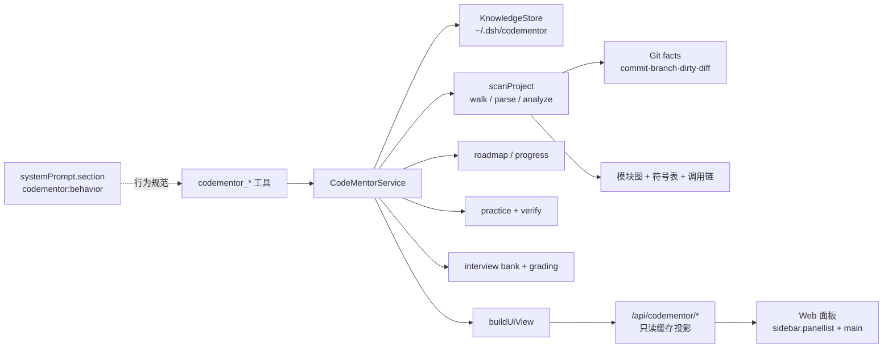

# CodeMentor — Project Code Learning & Engineering Mentor

把代码仓库转化为**可交互、可验证、可持续学习**的工程训练环境。CodeMentor 是 DeepSeek Harness（DSH）的 Cordis 插件，不修改 Agent Loop，不重复实现文件读取、搜索、终端、模型调用与会话持久化能力。

- 包名：`@local/codementor`
- 版本：`1.0.0`
- 运行形态：Host 插件（8 个工具 + 系统提示段 + 只读 HTTP 投影）+ Client 插件（`sidebar.panellist` / `main` 中的 CodeMentor 面板）
- 数据目录：`~/.dsh/codementor`（可用 `dataDir` 覆盖），**不写入业务仓库**

---

## 1. 能力总览

| 模块 | 能力 | 对应工具 |
|---|---|---|
| A. 项目自动分析 | 语言/构建/入口/模块依赖/符号/调用链/并发/存储/测试/CI/风险，每条结论带 `path:line` 与证据类别 | `codementor_scan`、`codementor_overview` |
| B. 源码精读定位 | 符号定义、调用点、文件符号表、跨函数调用链（带置信度与外部调用） | `codementor_explore` |
| C. 个性化学习路线 | P0/P1/P2、30 分钟 / 2 小时 / 深度学习预算、前置依赖排序、下一步建议 | `codementor_roadmap`、`codementor_progress` |
| D. 工程实战 | 真实源码练习题、修改前检查、guided/coop/reference 三档指导、可执行验证闭环 | `codementor_practice` |
| E. 技术面试 | 基于真实源码的题库、一问一答、四维评分、逐层追问、薄弱点记录、推荐回答 | `codementor_interview` |
| F. 跨会话知识 | Git Commit + 文件 mtime/size 增量缓存、受影响结论标记 stale、多项目隔离 | `codementor_refresh` + 内部 `KnowledgeStore` |

**诚实性约束（内建）**

- 每条实现事实都携带证据；`kind` 只会是 `source` / `doc` / `inference` / `unverified`。
- README 与源码冲突时以源码为准，并输出 `conflicts`。
- 符号解析是**启发式**的（注释/字符串掩码 + 结构扫描），不是 AST；输出里明确标注。
- 未执行的验证步骤永远标记为 `skipped/manual`，不会被描述为通过。

---

## 2. 快速开始

插件已安装到当前 profile 时，直接在对话中使用：

```text
codementor_scan path="C:/path/to/project"
codementor_overview path="C:/path/to/project"
codementor_explore path="C:/path/to/project" target="cmd_dispatch" mode="chain" depth=5
codementor_roadmap path="C:/path/to/project" goal=onboarding level=intermediate mode=2h
codementor_progress path="C:/path/to/project" action=record module="Core/Src" level=2 evidence_kind=explained detail="能解释 main→cmd_dispatch→rtc_set_time" ref="Core/Src/main.c:249"
codementor_practice path="C:/path/to/project" action=list
codementor_practice path="C:/path/to/project" action=brief task_id="#1" mode=coop
codementor_practice path="C:/path/to/project" action=verify task_id="#1" authorized=true steps='["diff-check","diff-stat"]'
codementor_interview path="C:/path/to/project" action=start difficulty=mid max_questions=3
codementor_interview path="C:/path/to/project" action=answer answer="……"
codementor_interview path="C:/path/to/project" action=report
codementor_refresh path="C:/path/to/project"
```

省略 `path` 时按顺序解析：当前会话工作目录 → `config.projectRoot` → 进程 cwd。

---

## 3. 插件架构



### 源文件

| 文件 | 职责 |
|---|---|
| `index.js` | Host 插件入口：8 个工具、系统提示段、只读路由、生命周期清理；输出统一经过 lossless JSON 归一化 |
| `lib/core.js` | 错误类型、语言表、注释/字符串掩码、括号匹配、评分与 `void` 返回类型判断 |
| `lib/fs-scan.js` | 文件清单（忽略构建产物/依赖目录）、命令执行（优先 `ctx.subprocess`）、Git 事实、知识库原子读写 |
| `lib/parse.js` | 启发式解析：C/C++、Python、Go、Java/C#/Kotlin、Rust、汇编、JS/TS；函数/结构/原型/导入/TODO/信号 |
| `lib/analyze.js` | 模块图、入口、调用链、数据结构生命周期、并发/存储、风险、文档冲突、Mermaid、stale 标记 |
| `lib/plan.js` | 优先级加权、时间预算、前置拓扑排序、证据门槛式进度、下一步推荐 |
| `lib/practice.js` | 练习题生成、修改前检查、三档 brief、验证计划与真实执行 |
| `lib/interview.js` | 题库生成、会话状态机、关键词覆盖评分、追问、薄弱点、报告 |
| `lib/service.js` | 项目解析、缓存生命周期、工具载荷与 Markdown 渲染、UI 视图模型 |
| `lib/define-tool.js` | 优先加载真实 `defineTool`，桌面安装下使用等价的无依赖回退实现 |
| `client.js` | Web 面板（React，经 `window.__ModuleLoader__` 注册），只读消费缓存 |
| `tests/run.mjs` | 36 项自动化测试（fixture + 真实多模块仓库） |

### 扩展点选择

- **工具**：`ctx.tools.register`（Agent 可调用；不另造文件/搜索/终端能力）。
- **行为规范**：`ctx.systemPrompt.section({ name:'codementor:behavior', order:9000 })`，只追加文本，不替换完整提示。
- **UI**：`ctx.slots.inject('sidebar.panellist' | 'main')`，不写 DOM、不替换应用根、不改主题。
- **数据**：Host 侧 `KnowledgeStore` 独立目录；Client 通过只读 HTTP 投影读取，Agent 与 UI 共用同一份缓存。
- **清理**：所有注册都包在 `ctx.effect` 中并返回 disposer；禁用插件后工具/路由/提示段全部移除（已实测）。

---

## 4. 工具参考

所有工具返回结构化 JSON，并附带中文 Markdown 渲染；`ok:false` 时返回 `error.code` / `error.message`，不会抛出到 Agent Loop（取消操作除外，`AbortError` 原样传播）。

### 4.1 `codementor_scan`

| 参数 | 类型 | 说明 |
|---|---|---|
| `path` | string | 本地项目路径；拒绝 `https://`/`git@` 等远程地址并提示先克隆 |
| `force` | boolean | 忽略 mtime/size 缓存，重新解析全部文件 |

输出：`project`（语言、清单、构建命令、Git）、`stats`、`modules`、`entryPoints`、`cache`、`change`、`diagnostics`、`skipped`、`warnings`。

### 4.2 `codementor_overview`

`section` 可选 `all/architecture/entry/chain/data/concurrency/storage/testing/build/risk/conflict`；`maxModules` 控制模块条数。

输出：一句话结论、主要问题、Mermaid 架构图、模块职责与依赖、典型调用链、启动路径、核心数据结构与生命周期、并发模型、存储、构建、风险、文档冲突、claims（带 kind/stale）、证据统计。

### 4.3 `codementor_explore`

`mode`：

- `symbol`：定义 + 调用点（同文件→同模块→首个定义消歧；原型优先降权）
- `file`：文件语言/行数/模块、符号、结构、导入、TODO
- `chain`：从符号出发的 BFS 调用链，`depth` 1–8；输出节点、边、主路径、未解析外部调用、`confidence`
- `search`：模块/结构/文件/TODO 元数据检索（原始文本请用 `grep`）
- `references`：调用点列表

### 4.4 `codementor_roadmap`

`goal` ∈ `overview/onboarding/module/maintenance/debug/feature/interview`；`level` ∈ `beginner/intermediate/advanced`；`mode` ∈ `30m/2h/deep`；`focus` 关键词。

评分（可配置权重）：

```text
score = w1·importance + w2·frequency + w3·goalRelevance + w4·dependency + w5·gap
P0：入口模块，或 score ≥ 0.55
P1：排名前 50% 且 score ≥ 0.2，或 score ≥ 0.35
P2：辅助模块、工具/文档目录、证据不足模块
```

- 学习顺序先按前置依赖做拓扑排序，再按评分排列。
- `doc/docs/tests/tools/scripts` 等辅助目录与低重要度根模块默认 P2，不占用 P0/P1 预算。
- 时间模式只是**内容预算**，不承诺掌握程度。

### 4.5 `codementor_progress`

`action` ∈ `list/record/next`。`record` 需要 `module`、`level`（0–5）、`evidence_kind`：

| 等级 | 含义 | 必需证据 |
|---|---|---|
| 0 | 未学习 | — |
| 1 | 已理解基本概念 | `read` 或 `explained` |
| 2 | 能解释真实调用链 | `explained` |
| 3 | 能独立定位相关代码 | `located` |
| 4 | 能独立修改并验证 | `modified` + `verified` |
| 5 | 能通过技术追问 | `interview` 且评分 ≥ 0.6 |

证据不足时**不会降级已获得等级**，也不会跳级；返回缺少的证据类型。

### 4.6 `codementor_practice`

`action`：

- `list` / `generate`：按类别均衡生成练习（todo / safety / boundary / error-handling / testing / refactor），默认 12 条
- `brief`：`task_id` 支持真实 id 或 `#1` 序号；`mode` ∈ `guided/coop/reference`
- `reference`：仅在机械可推导时给出补丁建议，`verified:false`
- `verify`：**必须** `authorized=true`；只执行验证计划中 `available=true` 的 argv；记录真实退出码与输出尾部

修改前检查固定包含：预期行为、当前行为、修改范围、依赖、不变量、风险等级/影响面、验证方案。

### 4.7 `codementor_interview`

`action` ∈ `start/question/answer/hint/report/bank`。

- 题库按维度生成：架构、调用链、数据结构、并发、性能、失败路径、设计取舍、代码修改场景。
- 默认一次只问一题；答完给四维评分（原理/源码/设计/表达）、纠错、推荐回答（简洁版+深入版），再决定追问/重问/下一题。
- 评分是**关键词覆盖 + 表达结构**启发式，不是 LLM 主观判断；输出里明确标注 `method` 与 `caveat`。
- 同一题最多重试一次，之后进入下一题；薄弱点写入项目知识库。

### 4.8 `codementor_refresh`

对比 Git Commit 与工作区：只重新解析 mtime/size 变化的文件，复用其余解析结果；改变证据文件的结论、调用链、练习被标记 `stale`；返回受影响模块与复用统计。

---

## 5. 知识库与增量更新

```text
~/.dsh/codementor/
├── index.json                      # 项目索引（id / root / commit / 更新时间）
└── projects/<slug>-<hash8>/
    └── knowledge.json              # 完整知识缓存
```

`knowledge.json` 关键字段：

```jsonc
{
  "schemaVersion": 1,
  "root": "C:/.../项目",
  "git": { "commit": "...", "branch": "main", "dirtyCount": 221, "recent": [] },
  "files": [ { "path": "Core/Src/main.c", "mtimeMs": 0, "size": 0,
               "symbols": [], "structures": [], "signals": {} } ],
  "modules": [], "symbols": [], "structures": [], "entryPoints": [],
  "chains": [], "analysis": { "claims": [], "mermaid": {} },
  "learning": { "plan": null, "progress": {} },
  "practice": { "tasks": [], "records": [] },
  "interview": { "bank": null, "sessions": [], "weakPoints": [] },
  "change": { "added": [], "modified": [], "removed": [], "gitDiff": null }
}
```

- 缓存按 `schemaVersion` 失效；`force` 触发全量重解析。
- 默认 10 分钟 TTL + 内存缓存；`refresh` 强制走增量路径。
- 多项目按 root 规范化路径哈希隔离，不会串项目事实。

---

## 6. Web 面板

侧边栏「CodeMentor 工程导师」→ 主面板，包含五个页签：

1. **项目全景**：一句话结论、架构 Mermaid、模块重要度、调用链与启动路径、数据结构生命周期、并发、构建、风险、claims。
2. **学习路线**：路线概览、P0/P1/P2 顺序、依据、前置、状态、下一步。
3. **代码探索**：模块树、符号表、调用链、结构、文件清单（全部带 `path:line`）。
4. **实践工坊**：任务列表、修改前检查、验证计划（可用性/不可用原因）。
5. **面试间**：题库、推荐回答、薄弱点、最近一次报告。

面板**只读**：只读取已分析缓存，不扫描文件系统、不执行命令。路由：

```text
GET /api/codementor/state             # 插件信息 + 项目列表
GET /api/codementor/project[?id=...]  # 最近/指定项目的只读视图
```

未扫描任何项目时，面板显示 `codementor_scan` 引导。

---

## 7. 安全与权限

- 默认**只读**；扫描、定位、路线、面试都不写业务仓库。
- 知识缓存只写入独立数据目录；写入采用临时文件 + 重命名。
- 修改类操作需要用户明确授权；`practice verify` 默认拒绝执行，`authorized=true` 才运行白名单内的 argv。
- 不自动克隆远程仓库；远程 URL 直接拒绝并提示本地克隆。
- 不自动执行破坏性命令、不提交/推送、不重置 Git。
- 敏感模式扫描（私钥、云密钥、通用凭据）只输出 `file:line` 与脱敏值，绝不输出原值。
- 仓库内文本只作为源码数据分析，不作为指令执行（防提示词注入）。
- 工具输出统一经过 lossless JSON 归一化，避免部分字段缺失导致调用失败。

---

## 8. 配置

在 `cordis.patch.yml` 的 `codementor` 行覆盖：

```yaml
- insert:
    - id: codementor
      name: '@local/codementor'
      config:
        projectRoot: ''
        dataDir: 'C:/Users/me/.dsh/codementor'
        cacheTtlMs: 600000
        commandTimeoutMs: 60000
        allowCommandExecution: true
        includeVendored: false
        maxFiles: 4000
        maxFileBytes: 524288
        maxParseFiles: 600
        excludeDirs: []
        vendoredDirs: []
        priorityWeights: { importance: 0.35, frequency: 0.2, goalRelevance: 0.2, dependency: 0.1, gap: 0.15 }
```

| 字段 | 默认 | 作用 |
|---|---|---|
| `projectRoot` | — | 未传 `path` 时的项目根 |
| `dataDir` | `~/.dsh/codementor` | 知识库目录 |
| `cacheTtlMs` | 600000 | 磁盘缓存复用窗口 |
| `commandTimeoutMs` | 60000 | 单条命令超时 |
| `allowCommandExecution` | true | 总开关；false 时 `verify` 永不执行 |
| `includeVendored` | false | 是否解析 Drivers/vendor 等第三方源码 |
| `maxFiles` / `maxFileBytes` / `maxParseFiles` | 4000 / 512 KiB / 600 | 扫描与解析预算 |
| `excludeDirs` / `vendoredDirs` | `[]` | 追加忽略/第三方目录 |
| `priorityWeights` | 见上 | 路线评分权重 |

---

## 9. 自动化测试

```bash
node tests/run.mjs
```

当前结果：**36 passed, 0 failed**。

覆盖：

- 掩码/括号匹配、C 函数/结构/原型/信号解析
- Manifest、bundle patch、locale、icon、client 语法
- 8 个工具注册、系统提示段、禁用/重新启用无残留
- 工具输出 lossless JSON、取消传播
- fixture 多模块工程的模块依赖、入口、调用链、explore
- 路线 P0/预算/前置排序/工具模块过滤/权重可解释
- 进度证据门槛（阅读不能跳级；modified+verified 才能到 4；interview≥0.6 到 5）
- 练习题分类均衡、guided/coop/reference、void 返回过滤、授权前不执行、授权后真实执行构建/测试
- 面试题库、单题会话、强答追问、弱答重试、报告与薄弱点
- 缓存复用、增量刷新、变更文件 stale 标记
- 缺失路径/远程 URL/空 target/无缓存等错误路径
- 真实多模块工程（STM32F407）入口、真实调用链、结构生命周期、路线、连续三轮追问、Keil 构建不可用的诚实说明

fixture：`tests/fixtures/sample-project`（C 多模块 + package.json 构建/测试命令 + CI + 文档）。

---

## 10. 真实仓库验收示例

仓库：`C:\Users\28935\Desktop\pp\批量转台球式\自研开发板STM32F407`（C / FreeRTOS 风格中断工程，Keil MDK + IAR + CubeMX）。

| 验收项 | 实测结果 |
|---|---|
| 识别入口/模块/构建 | `Reset_Handler`（MDK-ARM/startup_stm32f407xx.s:168）→ `main`（Core/Src/main.c:135）；9 个模块；Keil `MDK-ARM/test.uvprojx`（不可自动执行，原因明确） |
| 定位真实功能源码 | `cmd_dispatch` 解析到 `Core/Src/cmd_handler.c:849`（不是头文件原型） |
| 跨函数调用链 | `main:249 → cmd_dispatch:856 → cmd_set_time:255 → rtc_set_time`，每步有调用点 |
| 数据结构生命周期 | `PID_TypeDef`（Core/Inc/pid.h:36，9 字段）；实例 `g_location_pid` / `g_speed_pid`（pid.c:4-5）；判定 `declared-no-release-evidence` |
| 学习路线 | 2h 模式：Core/Inc → Core/Src → MDK-ARM；`doc`、(root)、`Core/Inc/arch` 因辅助/证据不足被排除 |
| 连续三轮追问 | `main→rtc_set_time` 调用链 → 失败返回路径 → 参数校验；三次评分均 strong（0.985） |
| 修改任务 + 验证方案 | `sscanf` 边界检查（Core/Src/cmd_handler.c:121）；验证计划含 `git diff --check`、`git diff --stat`、Keil（不可用）、手工回归 |
| 第二次进入复用 | `refresh` 返回 `up-to-date`，复用 51 个文件，重新解析 0 |
| 错误路径 | 不存在路径 → `PROJECT_NOT_FOUND`；远程 URL → `REMOTE_REPOSITORY`；空 target → `INVALID_TARGET` |
| UI | 侧边栏/主面板注册 active；`/api/codementor/project` 返回约 93 KB 只读视图 |

**关于验证的诚实记录**：`git diff --check` 在真实仓库上实际执行并**失败**（exit 2，构建产物与文档存在行尾空白）；`git diff --stat` 执行通过。演示中未执行 Keil 构建，也未修改任何业务源码。

---

## 11. 已知限制

1. **符号解析是启发式**：宏、条件编译、函数指针、模板、重载、跨文件同名符号需要人工核对；所有节点标注 `confidence`。
2. **默认不解析第三方源码**（`Drivers`/`Middlewares` 等）：只统计文件/字节，不索引符号；需要时设 `includeVendored: true`（受解析预算限制）。
3. **没有 LSP/AST/编译数据库**：C 的隐式声明、复杂宏展开、K&R 定义可能漏检；调用链可能含 `inferred` 或外部调用。
4. **构建可用性不探测工具链**：Keil/IAR/CMake 是否安装不预判；执行失败会如实记录，不会伪称通过。
5. **面试评分是关键词覆盖启发式**：能发现遗漏，但不能证明技术判断一定正确；以证据行为准。
6. **UI 只读**：面板不触发扫描、不执行命令；学习动作仍在对话中完成。
7. **不自动克隆远程仓库**；请先本地克隆。
8. **大仓库预算**：超出 `maxFiles` / `maxParseFiles` 会截断并报告 diagnostics。
9. **增量粒度是文件**：文件内局部改动会重解析整个文件，但不重解析未变化文件。

---

## 12. 阶段状态

| 阶段 | 状态 |
|---|---|
| Phase 1：扫描/架构/定位/调用链/路线/面试/缓存 | ✅ 完成并验证 |
| Phase 2：修改练习/Diff/风险评估/构建与测试执行/验证记录/错题 | ✅ 完成并验证（真实命令执行 + 诚实失败） |
| Phase 3：交互式架构视图/复杂状态机/增量更新/进度可视化/符号联合检索 | 🟡 部分：UI 五页签、Mermaid、增量刷新、进度可视化已完成；状态机自动分析、LSP/语义联合检索未做 |

---

## 13. 安装 / 卸载

安装（在 DSH 会话中使用 `plugin_manager`）：

```text
plugin_manager action=install_bundle target="C:/Users/28935/Documents/deepseek-harness/default-workspace/codementor"
```

- 已实测：`application: applied`，8 个工具出现，`sidebar.panellist` 与 `main` 注册 active。
- 修改 Host 代码后，用 `set_plugin` 禁用再启用即可重新加载当前模块；升级已安装包后若提示 `restart-required`，重启 DSH。
- 禁用后工具从 `Tool.listTools` 消失；重新启用后恢复（已实测）。
- 卸载：

```text
plugin_manager action=remove_bundle target="@local/codementor"
```

卸载不会删除 `~/.dsh/codementor` 中的知识缓存；需要时手动删除该目录。

---

## 14. 开发

```bash
cd codementor
node tests/run.mjs            # 36 项测试
node -e "import('./index.js')" # 模块自检
```

约束：不引入依赖、不修改 DSH 核心、不写 profile 的 `package.json` / `cordis.patch.yml`（安装由 `plugin_manager` 完成）。

---

## 15. 设计取舍摘要

- **为什么不上 Tree-sitter**：MVP 需要在任意 DSH 桌面安装中零依赖运行；掩码 + 结构扫描在 C/JS/Python/Go 上已能提供可核对的定位，且成本低。解析置信度被显式暴露，而不是伪装成精确。
- **为什么缓存放 Host 而不是 Session 事件**：知识是派生缓存，Session 日志才是事实来源；放独立目录可跨会话复用，也不会写坏 Session 格式。
- **为什么 UI 只读**：UI 扩展成本高、风险大；第一版先保证 Agent 工具闭环，再用只读投影提供可视化，避免 UI 成为第二个事实来源。
- **为什么练习先给线索而不是补丁**：避免学习者对 AI 产生依赖；参考实现只在明确请求时给出，并标记未验证。
- **为什么验证要分 executed / skipped**：工程上最常见的谎言是“构建应该能过”；CodeMentor 只记录真实退出码。

---

## 16. 许可与归属

插件代码为本次交付原创；图标 `icon.svg` 为原创 SVG。未打包任何第三方源码或素材。
